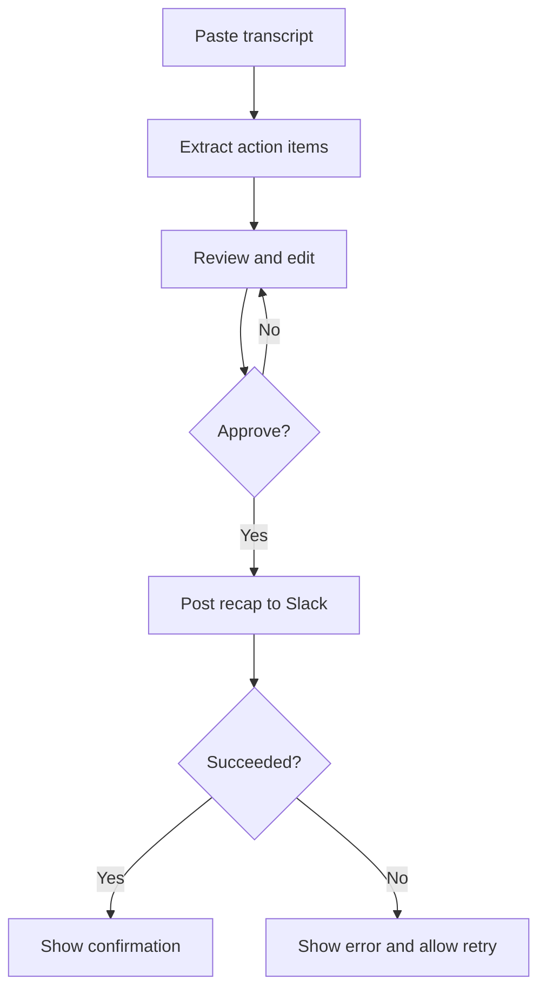

# Business Requirements Document (BRD)
## Meeting Action Items to Slack
**Version:** 1.0 | **Status:** Baseline | **Scope:** Week 1 MVP

### Business problem
Meeting coordinators manually read transcripts, identify commitments, assign owners and send Slack recaps. This takes time and risks missed follow-ups.

### Objective
Reduce manual recap work by extracting actionable commitments from pasted transcripts and letting a human verify them before sending to Slack.

### Users
Executive assistants, project managers and meeting coordinators.

### In-scope requirements
- BR-01: Paste a meeting transcript into a web interface.
- BR-02: Extract tasks and stated owners; capture explicit deadlines when present.
- BR-03: Review, edit, add or remove proposed action items.
- BR-04: Require an explicit approval action before posting a formatted recap to a configured Slack channel.
- BR-05: Show success or a clear failure message.

### Out of scope
Live transcription, automatic posting, Google Drive monitoring, HR directory lookup, email routing, accounts, analytics and complex integrations.

### Workflow

### Success metrics and acceptance criteria
- Given a sample transcript with three clear commitments, all three are presented for review with correct task descriptions.
- Unstated owners or deadlines are marked unspecified, never invented.
- A user can correct a task before sending.
- No Slack post occurs before approval.
- An approved recap reaches the configured test channel; failures are visible.
- The end-to-end workflow can be demonstrated in a short live presentation.

### Assumptions and dependencies
An AI model/API will be configured for extraction, and the tester will have permission to post to a Slack test channel. API credentials and Slack webhook tokens must not be committed.
